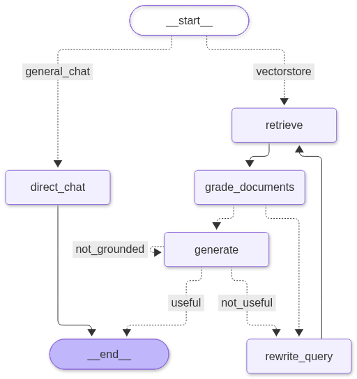

# DocAgent: Self-Hosted Knowledge Bucket and Adaptive RAG

DocAgent is a local-first, production-ready Retrieval-Augmented Generation (RAG) system built with Next.js, LangGraph, FastAPI, ChromaDB, SQLite, and Ollama. It features a document Knowledge Bucket, self-reflective answer evaluation, persistent multi-thread history, and dynamic mode switching between strict document grounding and open conversation.



---

## What Was Built (Architecture Overview)

This project was built from scratch to demonstrate full-stack AI engineering, agent orchestration, and reliable RAG system design:

1. **Adaptive LangGraph RAG Pipeline**:
   - **Intent Routing (`route_question`)**: Evaluates incoming queries using Pydantic structured output (`RouteQuery`) to decide between general chat and vector retrieval.
   - **Vector Retrieval (`retrieve`)**: Queries ChromaDB for the top relevant document chunks using local embeddings.
   - **Document Relevance Grading (`grade_documents`)**: Uses structured output (`DocumentRelevance`) to filter out irrelevant chunks in a single pass before passing context to the generator.
   - **Iterative Query Rewriting (`rewrite_query`)**: Rewrites the question to improve semantic match if retrieved chunks are irrelevant (bounded to 2 retries).
   - **Answer Synthesis (`generate`)**: Synthesizes grounded answers citing sources inline `[Source: filename (chunk X)]`.
   - **Self-Reflective Answer Grading (`grade_answer`)**: Verifies whether the generated answer is grounded in facts (hallucination detection) and directly addresses the user's question before returning.

2. **Pydantic Structured Output**:
   - Uses LangChain's `.with_structured_output(..., method="json_mode")` across all routing and grading nodes.
   - Strictly enforces JSON schemas with open-source models, preventing parsing failures in LangSmith traces.

3. **Hybrid Inference Engine**:
   - **Chat / Reasoning**: Supports cloud-hosted models (`gemma4:31b` via Ollama Cloud) or local models (`qwen3:1.7b`).
   - **Embeddings**: Uses local embeddings (`qwen3-embedding:0.6b` on `localhost:11434`) for high-throughput, private vector search with zero cloud dependencies.

4. **Document Knowledge Bucket**:
   - FastAPI endpoints (`/api/bucket`, `/api/bucket/upload`, `/api/bucket/{filename}`) for uploading, chunking, and embedding PDFs, Markdown, and plain text.
   - Real-time client UI with direct text pasting, file drag-and-drop, and document deletion.

5. **SQLite Persistence and Custom AG-UI Hydration**:
   - Replaced ephemeral memory with an SQLite persistence layer (`threads` and `messages` tables).
   - Implemented a custom `SQLiteAgentRunner` extending CopilotKit's runtime to replay full chat history (`RUN_STARTED`, `MESSAGES_SNAPSHOT`, `RUN_FINISHED`) when switching threads.

6. **Strict Document Mode vs. General Chat Toggle**:
   - UI toggle backed by SQLite settings table (`/api/settings`).
   - **General Chat (Default)**: Normal routing between conversation and document retrieval.
   - **Strict Mode**: Bypasses general chat completely, forcing vector retrieval. If documents do not contain the answer, it returns a verified fallback message instead of hallucinating.

7. **Containerization**:
   - Multi-stage Next.js standalone runner (`Dockerfile`).
   - Python 3.12 backend container with Astral `uv` (`agent/Dockerfile`).
   - Docker Compose orchestrating both services with volume mounts for database persistence and `host-gateway` networking for host Ollama access.

---

## Quick Start with Docker (Recommended)

Run the entire application with one command:

```bash
# 1. Clone the repository
git clone https://github.com/maaaz5/docagent.git
cd docagent

# 2. Configure environment variables
cp .env.example .env

# 3. Pull required Ollama models on your host machine
ollama pull qwen3-embedding:0.6b
ollama pull qwen3:1.7b

# 4. Start all services
docker compose up -d
```

The application will be available at:
- Web Application: http://localhost:3000
- Knowledge Bucket and Threads API: http://localhost:8000/docs
- LangGraph Agent: http://localhost:8123

ChromaDB (`agent/chroma_db`) and SQLite conversation history (`agent/threads.db`) persist automatically to your host filesystem.

---

## Local Development (Without Docker)

### Prerequisites

- Node.js 20+
- Python 3.12+
- [uv](https://docs.astral.sh/uv/) (Fast Python package manager)
- [Ollama](https://ollama.com/) running locally

### Installation

1. Install frontend and backend dependencies:

```bash
# Install frontend dependencies
npm install --ignore-scripts

# Install backend dependencies via uv
cd agent
uv sync
cd ..
```

2. Configure environment:

```bash
cp .env.example .env
```

3. Ensure local models are pulled in Ollama:

```bash
ollama pull qwen3-embedding:0.6b
ollama pull qwen3:1.7b
```

4. Start the development servers:

```bash
npm run dev
```

This concurrently starts:
- Next.js frontend on port 3000
- LangGraph agent on port 8123
- FastAPI Bucket API on port 8000

---

## Configuration

Settings in `.env`:

```env
AGENT_URL=http://localhost:8123
NEXT_PUBLIC_BUCKET_API_URL=http://localhost:8000

# Ollama Mode Selection: "cloud" or "local"
OLLAMA_CHAT_MODE=cloud
OLLAMA_EMBED_MODE=local

# Cloud Ollama Settings (Chat / Reasoning)
OLLAMA_CLOUD_URL=https://ollama.com
OLLAMA_CLOUD_API_KEY=your-api-key-here
OLLAMA_CLOUD_MODEL=gemma4:31b

# Local Ollama Settings (Embeddings / Local Chat)
OLLAMA_LOCAL_URL=http://localhost:11434
OLLAMA_LOCAL_EMBED_MODEL=qwen3-embedding:0.6b
OLLAMA_LOCAL_MODEL=qwen3:1.7b

# Optional: LangSmith Tracing
LANGSMITH_TRACING=true
LANGSMITH_ENDPOINT=https://api.smith.langchain.com
LANGSMITH_API_KEY=your-langsmith-key
LANGSMITH_PROJECT=docagent
```

---

## Project Structure

```
docagent/
├── agent/                      # Python backend service
│   ├── src/
│   │   ├── nodes/              # LangGraph workflow nodes
│   │   │   ├── retrieve.py     # Vector store retrieval
│   │   │   ├── grade_documents.py # Pydantic document grading
│   │   │   ├── generate.py     # Grounded answer synthesis
│   │   │   ├── grade_answer.py # Hallucination & relevance check
│   │   │   ├── rewrite_query.py # Query optimization
│   │   │   └── direct_chat.py  # Conversational fallback
│   │   ├── db.py               # SQLite persistence (threads, messages, settings)
│   │   ├── edges.py            # Graph routing logic (RouteQuery)
│   │   ├── model.py            # Ollama model and embeddings factory
│   │   ├── rag.py              # ChromaDB vector store and chunking
│   │   └── state.py            # GraphState definition
│   ├── bucket_api.py           # FastAPI server (Bucket, Threads, Settings)
│   ├── main.py                 # LangGraph state machine definition
│   ├── serve.py                # Standalone AG-UI server for Docker
│   ├── Dockerfile              # Backend container definition
│   └── tests/                  # Unit and integration test suite
├── src/                        # Next.js frontend application
│   ├── app/                    # App router and CopilotKit API route
│   ├── components/
│   │   ├── chat-mode-toggle.tsx # Strict Mode / General Chat toggle
│   │   ├── knowledge-bucket/   # Document ingestion and vector status UI
│   │   └── threads-sidebar/    # SQLite conversation sidebar
│   └── runner.ts               # Custom SQLiteAgentRunner for AG-UI hydration
├── docs/
│   └── workflow.png            # Compiled LangGraph workflow diagram
├── docker-compose.yml          # Container orchestration
├── Dockerfile                  # Next.js standalone container
└── LICENSE                     # MIT License
```

---

## Running Tests

Run the backend unit test suite:

```bash
cd agent
uv run pytest -m "not integration"
```

To run full integration tests against active Ollama models:

```bash
cd agent
uv run pytest
```

---

## License

This project is licensed under the MIT License. See [LICENSE](LICENSE) for details.
